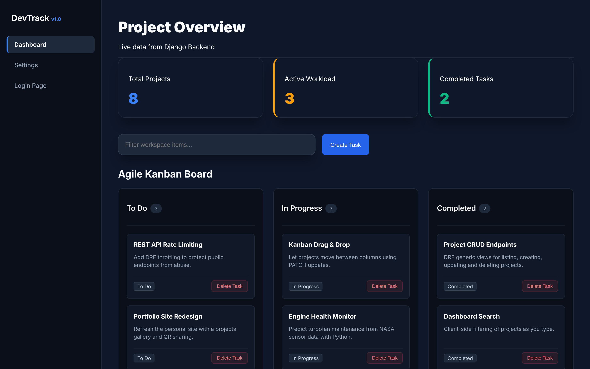
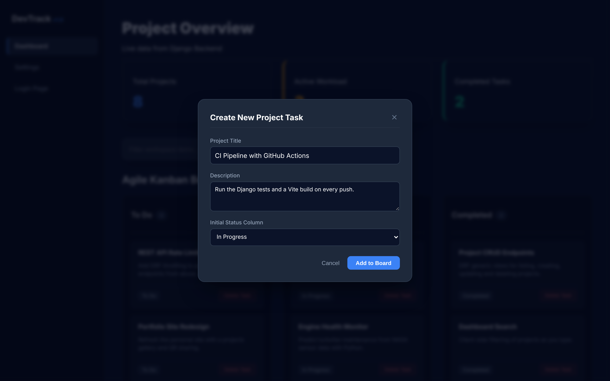
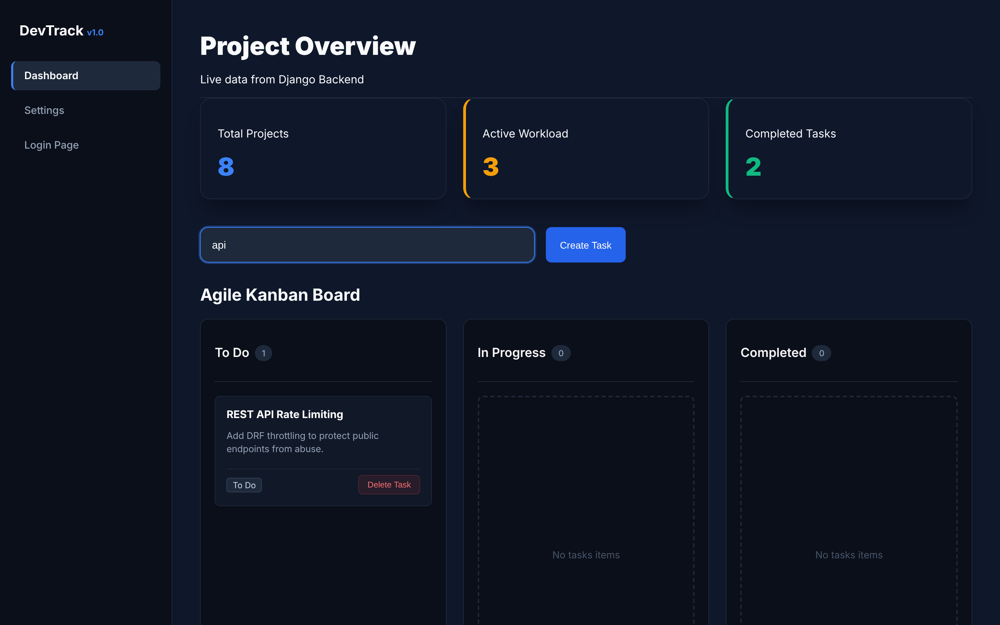
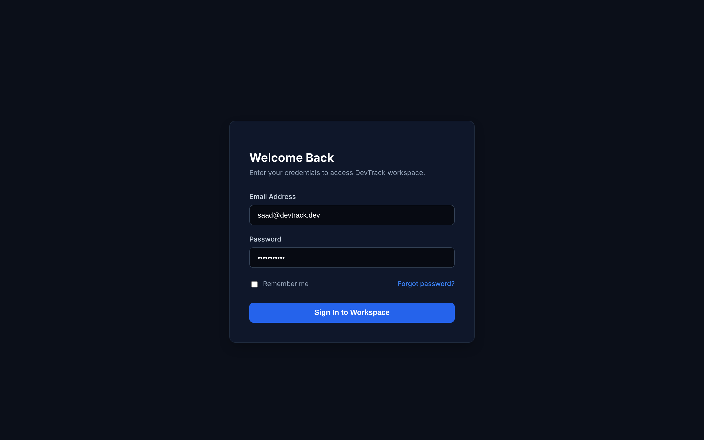
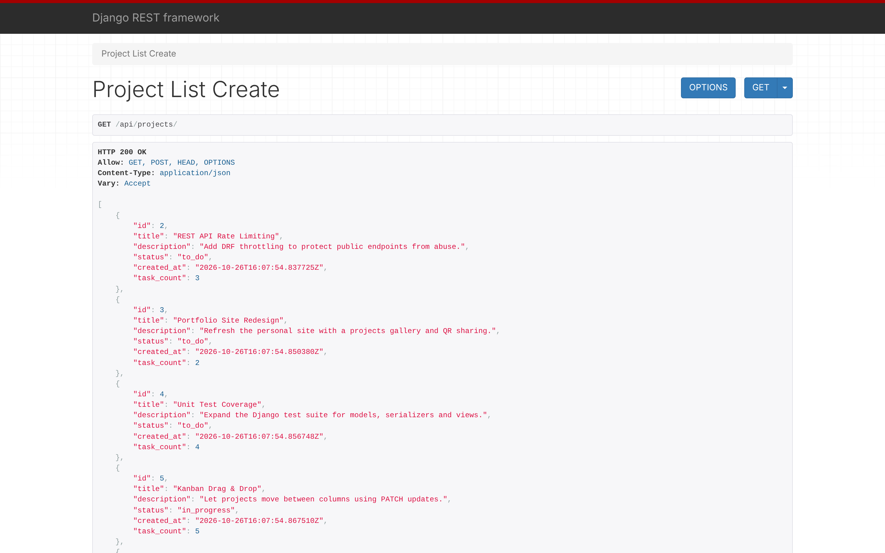

# DevTrack

A full-stack project tracking app with a Kanban-style dashboard, built with **React (Vite)** on the front end and a **Django REST Framework** API on the back end.

I built DevTrack to practise designing a REST API from scratch, modelling relational data in Django, and connecting it to a modern React front end.



## Screenshots

| Create a project | Live search |
| --- | --- |
|  |  |
| **Login page** | **REST API (DRF browsable view)** |
|  |  |

More in [`docs/screenshots`](docs/screenshots).

## Features

- **Kanban dashboard** – projects are grouped into *To Do*, *In Progress* and *Completed* columns based on their status.
- **Create and delete projects** – a modal form sends new projects to the API, with a starting status column; projects can be deleted from the board.
- **Live project stats** – the API annotates each project with a `task_count` using Django ORM aggregation (`Count`), and the dashboard shows totals per status.
- **Search** – filter projects on the dashboard as you type.
- **Validation** – the serializer rejects duplicate project titles with a clear error message.
- **Accessible forms** – every input has a linked label, and icon or repeated buttons have descriptive names for screen readers.
- **Multi-page navigation** – React Router with a sidebar layout, plus dashboard, settings and login pages.

## Tech stack

| Layer | Tools |
| --- | --- |
| Front end | React 19, Vite, React Router, Axios, custom CSS (Tailwind CSS and shadcn/ui are installed but not yet wired in) |
| Back end | Python, Django, Django REST Framework, django-cors-headers |
| Database | SQLite |

## API endpoints

| Method | Endpoint | Description |
| --- | --- | --- |
| GET | `/api/projects/` | List all projects (with task counts) |
| POST | `/api/projects/` | Create a project |
| GET | `/api/projects/<id>/` | Get a single project |
| PUT / PATCH | `/api/projects/<id>/` | Update a project |
| DELETE | `/api/projects/<id>/` | Delete a project |
| GET | `/api/health/` | Health check – returns `{"status": "ok"}` |

## Data model

- **Project** – title, description, status, created date, optional owner
- **Task** – belongs to a project; has a priority (Low / Medium / High), owner and optional category
- **Category** – name with an auto-generated URL slug
- **Developer** – links users to the tasks they're assigned

## Project structure

```text
DevTrack/
├── backend/
│   ├── config/        # Django settings and root URLs
│   ├── projects/      # Models, serializers, views and URLs for the API
│   ├── core/          # Health-check endpoint and tests
│   └── manage.py
└── frontend/
    └── src/
        ├── components/  # Dashboard, Kanban board, modals, layout, UI components
        ├── pages/       # Login, settings, categories
        ├── services/    # Axios API client
        └── App.jsx      # Routing
```

## Running locally

**Prerequisites:** Python 3.12+ (Django 6 requires it) and Node.js 20.19+ (Vite 7 requires it).

Run the back end and front end in **two separate terminals**.

**1. Back end** – API at http://127.0.0.1:8000/api/projects/

```bash
cd backend
python -m venv venv
source venv/bin/activate        # Windows: venv\Scripts\activate
pip install -r requirements.txt
python manage.py migrate
python manage.py runserver
```

Check it's up: http://127.0.0.1:8000/api/health/ should return `{"status": "ok"}`. Run the tests with `python manage.py test`.

**2. Front end** – app at http://localhost:5173

```bash
cd frontend
npm install
npm run dev
```

The front end calls the API at `http://localhost:8000/api` (set in `frontend/src/services/api.jsx`), so keep the back end on port 8000. The board starts empty on a fresh database – click **Create Task** to add your first project.

**Troubleshooting**

- *"Connection Refused. Is the Django server running on port 8000?"* – start the back end first, then refresh.
- *Vite says port 5173 is in use* – it will pick the next free port (e.g. 5174); that still works, as the API allows any origin in development.

## Current status and roadmap

DevTrack is a work in progress. Next steps:

- [ ] Task endpoints (the `Task` model exists; the API currently covers projects)
- [ ] Moving projects between columns from the board (the API already supports updates)
- [ ] Authentication – the login page is UI only so far
- [ ] Categories page and rich-text descriptions (Tiptap editor started)
- [ ] Expand the test suite
- [ ] Move `SECRET_KEY` and `DEBUG` into environment variables

## What I learned

- Designing REST endpoints with DRF generic views (`ListCreateAPIView`, `RetrieveUpdateDestroyAPIView`)
- Using ORM aggregation (`annotate` + `Count`) to send computed data to the front end
- Evolving a schema safely through Django migrations
- Structuring a React app with routing, reusable components and a central API client
